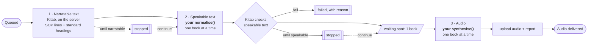

# Kitab External Runs: start here

One guide for running the external stages: set up the repo on your machine, see how a book flows, and plug in your
speakable-text step and your audio step, as Python functions or as HTTP endpoints. Nothing is hosted: you pull the
repo and run the server, the UI and the runner yourself.

## 1. Set up and run (10 minutes)

Needs Python 3.10 or newer (tested on 3.10 and 3.13) and git. Works on macOS and Linux.

```bash
git clone git@github.com:imrajeshkitab/kitab-external-runs.git && cd kitab-external-runs
python3 -m venv .venv && .venv/bin/pip install -r requirements.txt
cp .env.example .env          # then fill in SUPABASE_SERVICE_KEY (shared with you separately) and EXTRUNS_RUNNER_KEY

.venv/bin/uvicorn extruns.api:app --port 8790        # 1) server + UI → http://localhost:8790
.venv/bin/python runner/kitab_runner.py              # 2) runner, in a second terminal (stand-in steps for now)
.venv/bin/python -m pytest -q                        # 3) tests (should all pass)
```

Everything runs on your machine. The server reads summaries, narrators and reference clips **directly from
Kitab's Studio Supabase** over HTTPS (the settings in `.env`); no hosted Kitab service (Vercel or other) is
involved, and audio never leaves your machine except where you send it. Without a `.env` the server still runs,
offline, from the test file.

Then in the UI: **New run** → language → tick **TEST - …** (TEST-0001) → *Until audio* → **Add**. Watch the book move
across **Runs**: stage 1 runs on the server, stages 2–3 in the runner. Open the card to see the stage thread,
the narratable text, the speakable text and the audio.

### Test summaries

Two test books live in our **Studio database** (`content.summaries`), next to the real summaries, so this app reads
them like any other book (and so does the Content API). They are copies of real summaries, marked `TEST - ` in the title, `source = 'test'`,
negative ids (the CMS sync only adds or updates by id, so it never touches them), and each has a narrator with a
reference clip in every language:

| Book | Languages | Why it's there |
|---|---|---|
| TEST-0001 | bengali, gujarati, kannada, malayalam, marathi, odia, tamil, telugu | passes stage 1 in all 8 languages: use it for every dry run |
| TEST-0002 | marathi, telugu | its intro has no heading (no tagline), so stage 1 blocks it on purpose: shows what a blocked book looks like |

With `.env` filled in, the server reads them (and the real summaries) straight from the Studio Supabase.
Without it, it works offline from `fixtures/test_summaries.json`: the same TEST rows, exactly as stored, every
column included.

## 2. How a book flows



| Step | Who | In | Out |
|---|---|---|---|
| Queue | anyone, in the UI or the API | books + how far to go (until narratable, speakable or audio) | books in Queued |
| 1 · Narratable text | Kitab code, runs inside the server | the summary as written | chapters with SOP spoken lines and standard headings; fixes logged; blocked books get a reason |
| 2 · Speakable text | **you**: `normalise(job)` | narratable chapters | the same chapters with numbers, symbols and emojis as words |
| Kitab checks | server, on arrival | your speakable chapters | pass, or *failed* with plain reasons (section 6) |
| 3 · Audio | **you**: `synthesise(job, out_dir)` | speakable chapters + `job["voice"]` (narrator and a signed link to their reference clip in this language) | one audio file + report (duration, model, chapter times) |
| Delivered | server | the upload | saved as `external/bala/<book>/<language>/attempt-<n>/…` |

A stopped book goes on with **Continue** (its card, a whole column, or a selection). Who runs each stage is a
setting (**Who runs each stage** in the UI): today stage 1 is Kitab's and 2–3 are yours, and if that changes,
nothing in your code changes.

## 3. Rules the system enforces

- **One book at a time per stage.** You can have one book in speakable text and one in audio at the same time,
  never two in the same stage.
- **One waiting spot before audio.** When a book has finished speakable text and is waiting for audio, the next
  book can't start speakable text until audio takes the waiting one. This stops the faster step from piling up
  work. You don't need to handle it: `claim` simply returns nothing until there is room.
- **Run until.** Each book's run goes only as far as Kitab asked: until narratable, speakable or audio. You'll only
  be given books whose run includes your stage.
- **Heartbeat and lease.** When you claim a book you hold it for 20 minutes. Every heartbeat renews that. If no
  heartbeat arrives for 20 minutes, the book goes back to waiting and anyone can claim it. Send one about every 60
  seconds while you work.
- **Kitab checks everything you send back.** If a check fails, the book shows *Failed* with the reason, and Kitab
  decides whether to run the stage again. Section 6 lists the checks.


## 4. Where you plug in your two steps

You write only the two steps. Pick one way:

**A. Python functions:** copy `extruns/adapters/my_adapters_template.py` to `extruns/adapters/my_adapters.py`, fill
in the two TODOs, then:

```bash
.venv/bin/python runner/kitab_runner.py --adapters extruns.adapters.my_adapters
```

```python
def normalise(job):            # job["narratable"]["chapters"] -> {"chapters": [...same chapters, speakable...]}
def synthesise(job, out_dir):  # job["speakable"]["chapters"]  -> {"audio_path", "ext", "report": {...}}
```

**B. Your own HTTP endpoints** (if your normaliser and model already run as services): no code to write.

```bash
NORMALISE_URL=http://localhost:9001/normalise SYNTHESISE_URL=http://localhost:9002/synthesise \
.venv/bin/python runner/kitab_runner.py --adapters extruns.adapters.http_endpoints
```

| Your endpoint | Receives (POST JSON) | Returns |
|---|---|---|
| normalise | `{"book_id", "linear_id", "language", "chapters": [{"index","kind","heading","text"}]}` | `{"chapters": [...same shape...], "normaliser": "name v1"}` |
| synthesise | `{"book_id", "linear_id", "language", "attempt", "chapters": [...speakable...]}` | `{"audio_base64": "...", "ext": "mp3", "report": {...}}` or `{"audio_path": "/local/file", "ext", "report"}` |

The report: `{"duration_s": 1262.4, "model": "name v1", "chapters": [{"index": 0, "start_s": 0.0, "end_s": 182.5}, …], "sentences": [optional]}`.

**C. No runner at all:** drive the API from your own scheduler or an AI assistant (sections 8–9).

Whichever you pick, the runner (or you) never chooses books or stages: the server hands out only what is allowed.

## 5. A dry run, step by step

1. Start the server and the runner with your adapters (A or B).
2. **New run** → *marathi* → TEST-0001 → *Until speakable* → Add. Your normaliser runs once; the card shows
   *Stopped here, as asked* and **Open** shows your speakable text, or *Failed* with the exact check that failed.
3. Fix anything the checks flag, then **Run this stage again** on the card.
4. **Continue to audio** on the card: your model runs once, the audio appears on the card with its saved name.
5. Repeat for the other 7 languages (select several cards, **Continue each to its next stage**).

## 6. What Kitab checks

**Speakable text (stage 2)**, checked as soon as you finish:

| Check | Fails with |
|---|---|
| Same number of chapters as the narratable text | "Speakable text has N chapters; the narratable text has M." |
| Same kind in the same place (intro, key_idea, conclusion) | "Chapter 3 is key_idea but should be conclusion." |
| Every chapter keeps a heading | "Chapter 3 lost its heading." |
| Every chapter has text | "Chapter 3 has no text." |
| Nothing a voice can't say: no ASCII digits, `# @ % & * _ = + < > [ ] { } \| \ / ~ ^ $ € £ ₹`, no links | "Chapter 2 still has '%', which a voice can't say." |
| At least 95% of letters in the language's own script | "Only 91.2% of the letters are in the tamil script (needs 95%)." |
| Length within 70–140% of the narratable chapter (chapters of 300+ characters) | "Chapter 4 is 62% the length of the narratable text…" |

So: keep every chapter and heading, in order. Turn **all** numbers into words, headings included ("मुख्य कल्पना 5
पैकी 1" → "मुख्य कल्पना पाच पैकी एक"). Write English words inside the text in the language's own script. Don't
summarise, add or drop sentences.

**Audio (stage 3)**: the audio file must be uploaded, the report needs `duration_s`, and `chapters`, when sent,
must have one entry per chapter. Fuller audio checks (silence, loudness, cut-off endings) and listening come later.


## 7. Connecting to the server

| | |
|---|---|
| Base URL | `http://localhost:8790`: the server you started in section 1 |
| Auth | header `X-Runner-Key` on every `/api/runner/...` call: `dev-runner-key` locally, or whatever you set in `EXTRUNS_RUNNER_KEY` for both server and runner |
| Format | JSON in and out, except the audio upload (raw bytes) |
| Your worker name | any stable string per process, e.g. `gpu-box-1`; send the same one on every call for a book |

Errors come back as HTTP status codes with `{"detail": "<plain sentence>"}`:

| Code | Meaning | What to do |
|---|---|---|
| 401 | missing or wrong `X-Runner-Key` | fix the key |
| 409 | not allowed right now, e.g. "This book is not running this stage for this worker" (your lease ran out, or the book was taken out of the run) | drop the book and claim the next one |
| 422 | malformed request | fix the body |
| 5xx | server problem | retry after a few seconds |


## 8. API reference (for scripts and AI assistants)

### Claim the next book for a stage

`POST /api/runner/claim`

```json
{"stage": "speakable", "worker": "gpu-box-1"}
```

Returns `{"book": null}` when there's nothing for you (no work, the stage is busy, the waiting spot is full, or the
stage isn't yours right now). Otherwise:

```json
{"book": {
  "id": 17, "linear_id": "SUM-199", "language": "marathi", "title": "द नाऊ हॅबिट",
  "until": "audio", "stage": "speakable", "status": "running", "attempt": 1,
  "narratable": {
    "chapters": [
      {"index": 0, "kind": "intro",      "heading": "द नाऊ हॅबिट, नील फिओरे. तुम्ही काय शिकाल? …", "text": "…"},
      {"index": 1, "kind": "key_idea",   "heading": "मुख्य कल्पना 5 पैकी 1: …", "text": "…"},
      {"index": 6, "kind": "conclusion", "heading": "निष्कर्ष", "text": "…"}],
    "text": "the whole narratable text in one block",
    "fixes": [], "warnings": []},
  "speakable": null}}
```

For `"stage": "audio"`, `speakable` holds the chapters you sent back in stage 2.

Fields you'll use: `id`, `language`, `narratable.chapters` (stage 2), `speakable.chapters` (stage 3), `attempt`.
For `"stage": "audio"` the book also carries `voice`: the narrator (`voice_id`, `name`, `gender`, `age`,
`pace`) and `reference` (`language`, `text`, `seconds`, `sample_rate`, `audio_url` = a signed link valid 24 hours).
No other call is needed.

### Heartbeat

`POST /api/runner/{id}/heartbeat` with `{"worker": "gpu-box-1", "note": "voicing chapter 4 of 7"}`. The `note` is
optional and shows in the book's history. A 409 means you no longer hold the book: stop working on it.

### Finish stage 2 (speakable text)

`POST /api/runner/{id}/finish`

```json
{"stage": "speakable", "worker": "gpu-box-1",
 "result": {"chapters": [
   {"index": 0, "kind": "intro", "heading": "…", "text": "…"},
   {"index": 1, "kind": "key_idea", "heading": "मुख्य कल्पना पाच पैकी एक: …", "text": "…"}]}}
```

Reply: `{"failed": false, "reasons": []}`, or `{"failed": true, "reasons": ["Chapter 3 lost its heading."]}`.

### Upload the audio (stage 3)

`POST /api/runner/{id}/audio?worker=gpu-box-1&ext=mp3` with the file's raw bytes as the body
(`Content-Type: application/octet-stream`). Any format is fine; `ext` says which. Kitab names and stores the file
(section 10). Reply: `{"path": "external/…"}`.

### Finish stage 3

`POST /api/runner/{id}/finish`

```json
{"stage": "audio", "worker": "gpu-box-1",
 "result": {"report": {
   "duration_s": 1262.4,
   "model": "your-model v1",
   "chapters":  [{"index": 0, "start_s": 0.0, "end_s": 182.5}, {"index": 1, "start_s": 182.5, "end_s": 360.1}],
   "sentences": [{"chapter": 0, "start_s": 0.0, "end_s": 4.2, "text": "…"}]}}}
```

Required: `duration_s` (seconds) and `model`. `chapters` is strongly wanted, one entry per chapter, in order.
`sentences` is optional. Anything else you add is kept as it is. Upload the audio **before** calling finish.

### Give up on a book

`POST /api/runner/{id}/fail` with `{"stage": "audio", "worker": "gpu-box-1", "reason": "model crashed on chapter 5"}`.
The book shows *Failed* with your reason, and Kitab decides what happens next.


## 9. The loop, if you call the API yourself

Run one loop per stage you own, side by side. Each loop holds at most one book.

```
loop for STAGE in {speakable, audio}:
    book = POST /api/runner/claim {stage: STAGE, worker: W}
    if book is null: wait 3 s; continue
    start a heartbeat every 60 s: POST /api/runner/{id}/heartbeat {worker: W}
    try:
        if STAGE == speakable:
            chapters = make_speakable(book.narratable.chapters)     # keep chapters, kinds, headings, order
            POST /api/runner/{id}/finish {stage, worker: W, result: {chapters}}
        else:
            file, report = make_audio(book.speakable.chapters, narrator + clip for book.language)
            POST /api/runner/{id}/audio?worker=W&ext=mp3   <bytes of file>
            POST /api/runner/{id}/finish {stage, worker: W, result: {report}}
    except anything:
        POST /api/runner/{id}/fail {stage, worker: W, reason: "<what went wrong>"}
    stop the heartbeat
```

The same in `curl`:

```bash
curl -s $BASE/api/runner/claim -H "X-Runner-Key: $KEY" -H "Content-Type: application/json" \
     -d '{"stage":"speakable","worker":"gpu-box-1"}'
curl -s $BASE/api/runner/17/heartbeat -H "X-Runner-Key: $KEY" -H "Content-Type: application/json" \
     -d '{"worker":"gpu-box-1"}'
curl -s $BASE/api/runner/17/finish -H "X-Runner-Key: $KEY" -H "Content-Type: application/json" \
     -d @speakable_result.json
curl -s "$BASE/api/runner/18/audio?worker=gpu-box-1&ext=mp3" -H "X-Runner-Key: $KEY" \
     -H "Content-Type: application/octet-stream" --data-binary @book.mp3
curl -s $BASE/api/runner/18/finish -H "X-Runner-Key: $KEY" -H "Content-Type: application/json" \
     -d '{"stage":"audio","worker":"gpu-box-1","result":{"report":{"duration_s":1262.4,"model":"v1"}}}'
```


## 10. File naming (done for you)

You upload bytes; Kitab saves them as:

```
external/<provider>/<linear_id>/<language>/attempt-<n>/<linear_id>_<language>_<provider>_a<n>.<ext>
external/<provider>/<linear_id>/<language>/attempt-<n>/<linear_id>_<language>_<provider>_a<n>.report.json
```

For example `external/bala/SUM-199/marathi/attempt-1/SUM-199_marathi_bala_a1.mp3`. A redo is a new attempt
number, so earlier files are never overwritten.


## 11. For an AI assistant working from this guide

If you are an AI assistant asked to run the external stages:

1. Ask the person for the base URL and the runner key. Never print or store the key anywhere but an environment
   variable.
2. Prefer running `runner/kitab_runner.py` with an adapters module wrapping their normaliser and model (section 4, option A).
   Write the two functions; don't change the runner.
3. If you call the API directly, follow section 9 exactly: one book per stage at a time, a heartbeat every 60 s,
   audio uploaded before finish, `fail` with a reason on any error.
4. Before sending speakable text, check it against section 6 yourself: same chapters and headings, no ASCII digits
   or symbols, the right script. Fix and resend nothing after `finish`: a failed book waits for Kitab.
5. Never claim a stage that isn't yours, never invent text, and never edit headings beyond writing numbers as words.


## 12. Our side of the API (queue, continue, run until)

These are what the web UI uses; the external side doesn't need them.

| Call | What it does |
|---|---|
| `GET /api/board?language=` | every book by place, owners, warnings |
| `GET /api/books/{id}` | one book with narratable/speakable text, report and history |
| `GET /api/eligible?language=` | books that can be queued |
| `POST /api/runs` `{items: [{linear_id, language, title}], until}` | queue books |
| `POST /api/books/continue` `{ids}` | move stopped books on one stage |
| `POST /api/books/until` `{ids, until}` | change how far books go |
| `POST /api/books/remove` `{ids}` | take books out of the run |
| `POST /api/books/{id}/rerun` | run a failed or stopped stage again |
| `GET/PUT /api/owners` | who runs each stage |
